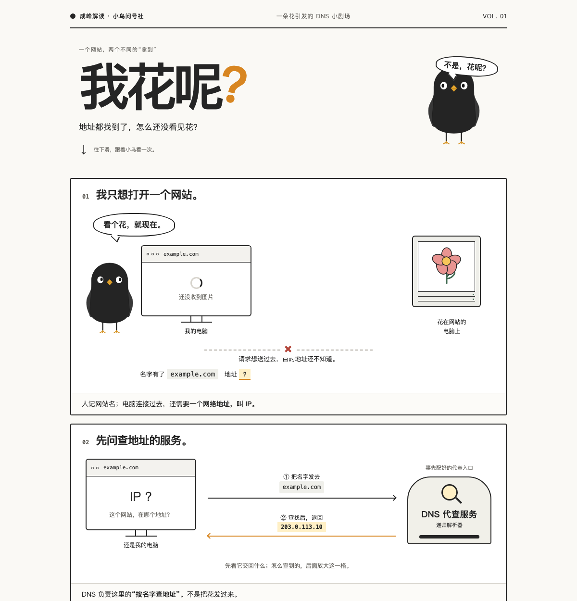
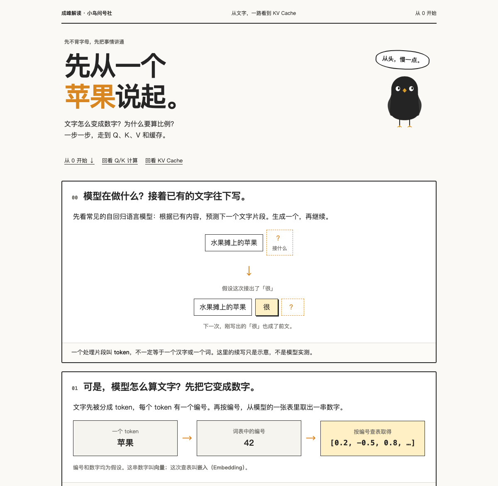
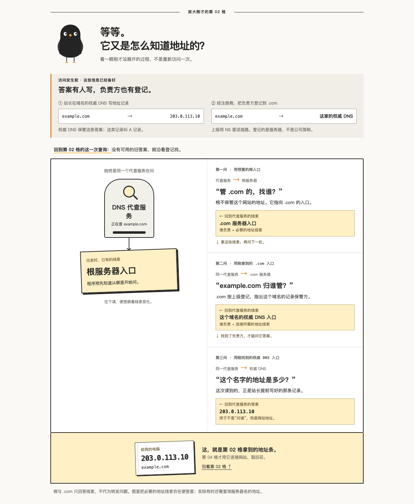
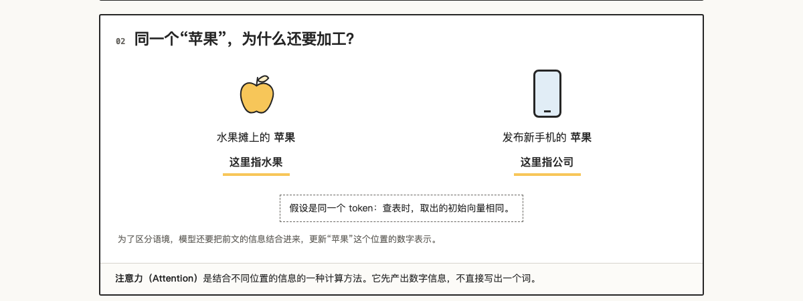

# 成峰解读 chengfeng-jiedu

> 把看不懂的概念，讲成一页一页往下滑的图解网页。

[](LICENSE)

问 AI 一个陌生概念，它常常回你一大段文字：每个字都认识，读完还是没懂。

成峰解读是一个给 Claude Code / Codex 等 Agent 用的 Skill。它让 AI 从一个具体例子讲起，每页只往前推一步，少用字、多用图，最后做成一个能往下滑着看的网页。哪里没看懂，接着问，它再补一页。

| DNS：小鸟想看一朵花 | KV Cache：先从一个苹果说起 |
|---|---|
|  |  |
|  |  |

## 安装

最简单的方式：把这句发给你的 AI，它会照着命令装好：

```text
帮我运行这条命令，安装成峰解读 Skill：npx -y github:Agentchengfeng/chengfeng-jiedu install
```

自己在终端装也行（需要 Node.js 18+）：

```sh
npx -y github:Agentchengfeng/chengfeng-jiedu install
```

装好后重启 Agent，让它重新加载 Skill 列表。

## 怎么用

遇到看不懂的东西，直接说：

```text
用成峰解读讲一下 KV Cache
```

```text
DNS 我没理解，做成图帮我看懂
```

它会先回答你当前卡住的地方；形成一段完整的解释后，生成一个 HTML 页面。

## 它会怎么讲

- **从具体例子开始**：先讲“小鸟想打开一个网站”，再讲 DNS；先讲“苹果”这个词，再讲 Q、K、V。
- **一页只推进一步**：每一页只多出一个新认识，前一页的结果是下一页的起点。
- **图来解释，字来点题**：遮住正文，只看图和短句，也能看出关系和变化。
- **术语用到时才出场**：先让你知道要解决什么，再告诉你它叫什么。
- **不为好懂编造**：类比和真实机制对不上时，改用直接演示。

## 不做什么

- 不做普通摘要，也不只是改写措辞。
- 一句话就能答清的问题，不硬做成网页。

## 检查与卸载

```sh
npx -y github:Agentchengfeng/chengfeng-jiedu doctor
npx -y github:Agentchengfeng/chengfeng-jiedu uninstall
```

安装器会把 Skill 放进本机 Agent 的 Skill 目录，已有的旧版本会先备份。包里只有说明文件和参考样张，不含 API key 或任何个人数据。

## 仓库结构

```text
chengfeng-jiedu/
├── SKILL.md
├── LICENSE / NOTICE.md / CITATION.cff
├── package.json
├── bin/install.js
├── docs/                      # README 示例截图
└── skills/chengfeng-jiedu/
    ├── SKILL.md
    ├── agents/openai.yaml
    ├── references/            # 视觉规范、特殊讲解场景、读者验证
    └── assets/                # 参考样张 HTML
```

## 官方来源

由 **成峰 / AI产品自由** 创建和维护。

- GitHub：[Agentchengfeng](https://github.com/Agentchengfeng) —— 安装问题和 bug 请提 Issue。
- X：[@chengfeng240928](https://x.com/chengfeng240928)
- 小红书 / 公众号 / B站 / 抖音 / 视频号：AI产品自由

## License

Apache-2.0。见 [LICENSE](LICENSE) 和 [NOTICE.md](NOTICE.md)。使用、翻译、转载或改编时，请保留署名与 NOTICE。
